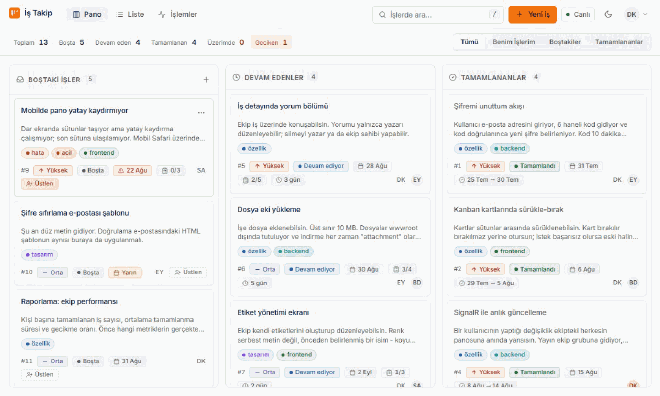
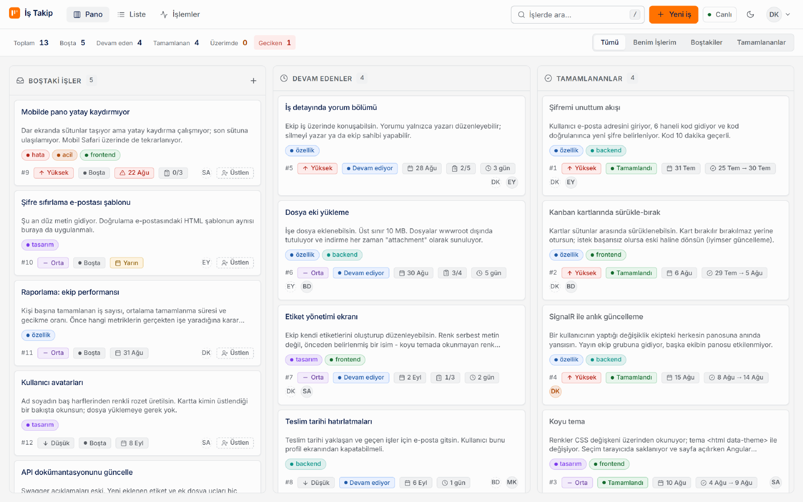
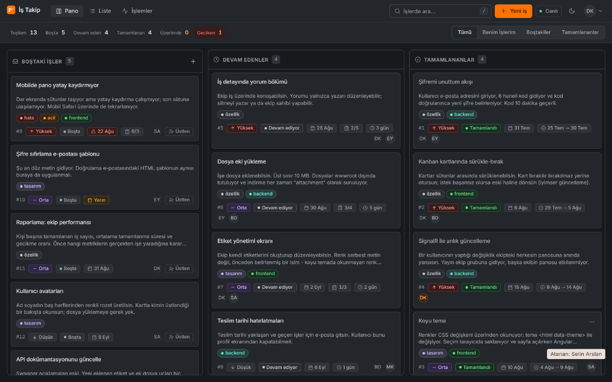
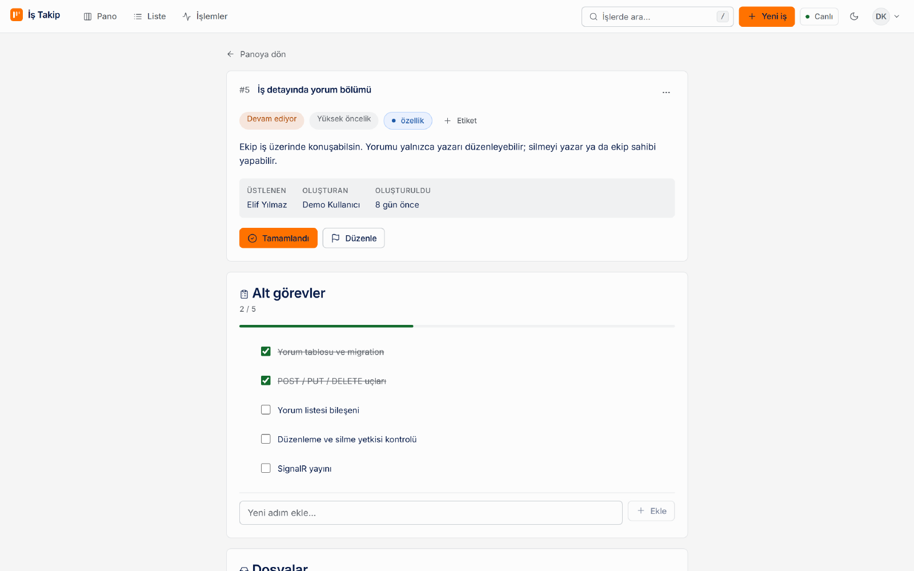
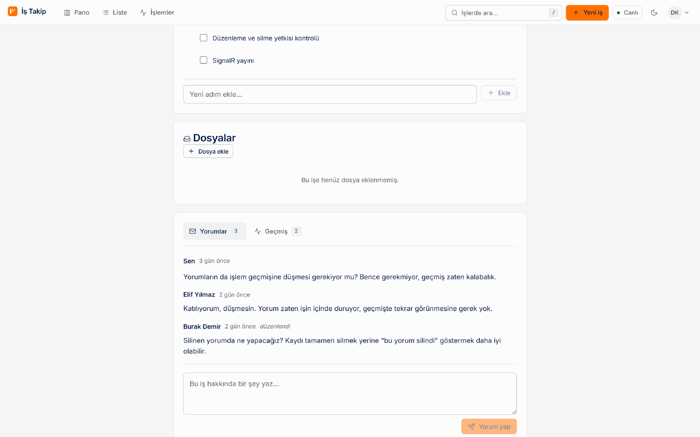
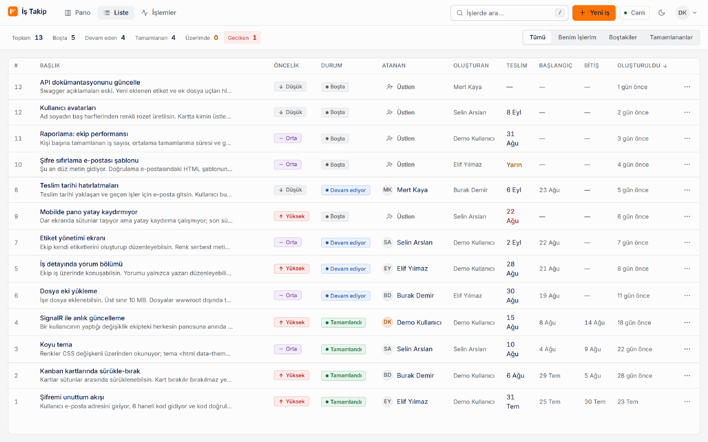
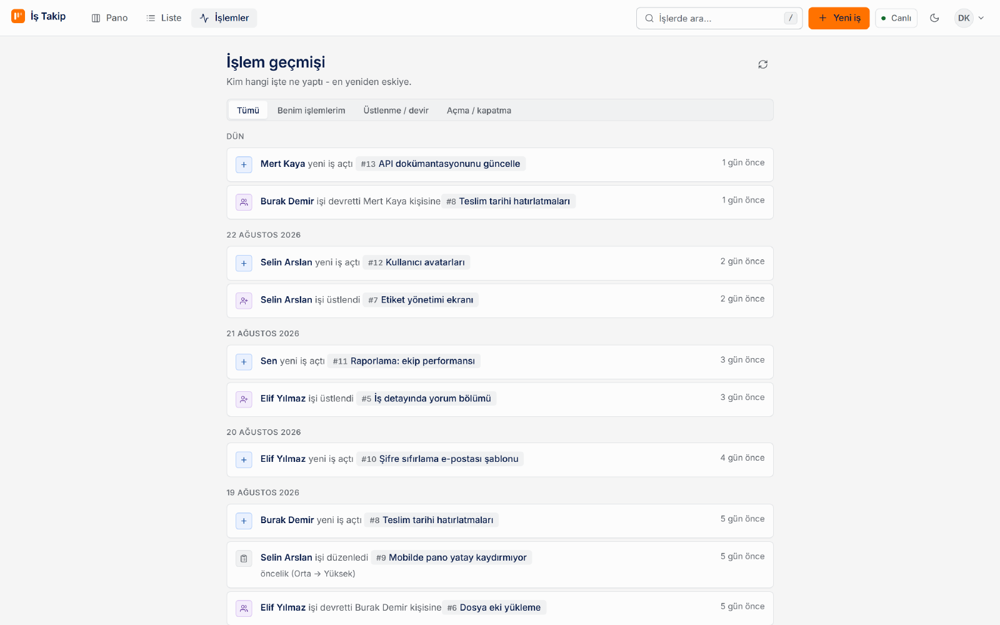
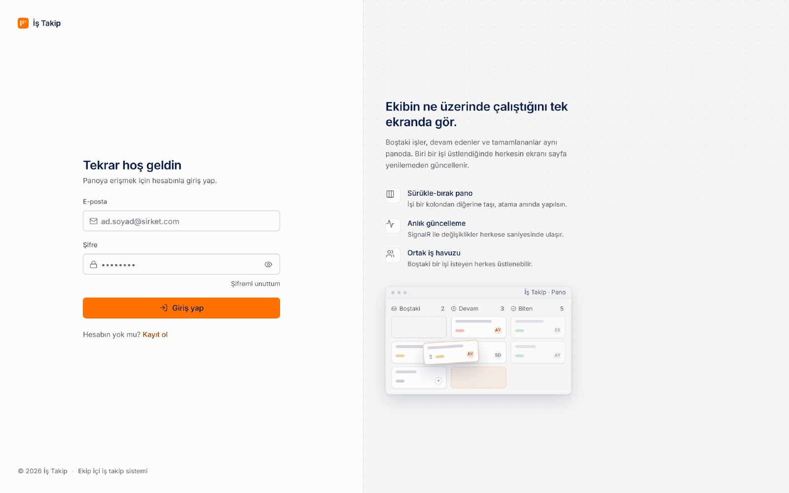
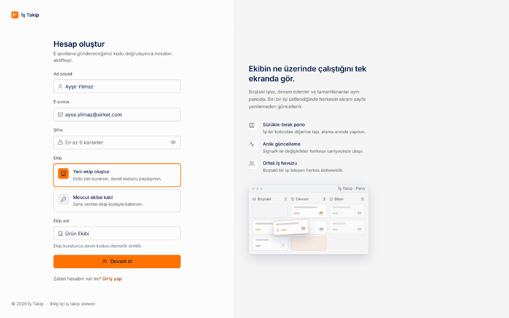

# İş Takip — Ekip İçi Görev Takip Sistemi

Ekip bazlı Kanban görev panosu. Her kullanıcı bir ekibe ait ve yalnızca kendi
ekibinin işlerini görüyor; değişiklikler SignalR ile bağlı olan herkese anında
ulaşıyor.

- **Backend:** .NET 10 Web API, Dapper, PostgreSQL, JWT, SignalR
- **Frontend:** Angular 21, Angular Material, signal tabanlı durum yönetimi
- **Dağıtım:** Docker Compose (PostgreSQL + API + nginx), GitHub Actions



> Kart bırakılır bırakılmaz yerine oturuyor; onay penceresinde "Vazgeç"
> denirse hiç taşınmamış oluyor. Değişiklik aynı anda ekipteki herkesin
> panosuna düşüyor.

---

## Hemen dene

Makinede .NET SDK, Node ya da PostgreSQL kurulu olmasına gerek yok — üçü de
konteynerden geliyor. İki komut yeterli:

```bash
cp .env.example .env    # POSTGRES_PASSWORD ve JWT_KEY doldurulmalı
docker compose up -d --build

docker compose --profile demo run --rm seed    # örnek ekip ve işler
```

Sonra **http://localhost:4200** adresini aç ve hazır hesapla gir:

|  |  |
|---|---|
| **E-posta** | `demo@istakip.local` |
| **Şifre** | `Demo1234` |

Bu hesap ekibin sahibi, yani her şeyi görebiliyor: iş oluşturma/silme, ekip
yönetimi, sahiplik devri. Panoda 13 iş, etiketler, kontrol listeleri, yorumlar
ve işlem geçmişi hazır geliyor.

> Kayıt akışını da denemek istersen ekip katılım kodu: **`KANBAN25`**.
> Doğrulama e-postası gerçekten gönderilmiyor; kod konteyner loguna düşüyor:
> `docker compose logs -f server`

**Docker kullanmıyorsan** ([elle kurulum](#elle-kurulum-dockersız) adımlarını
tamamladıktan sonra) demo verisi tek komut — bu adım atlanırsa yukarıdaki
hesaplar veritabanında olmadığı için giriş `E-posta veya şifre hatalı` der:

```bash
psql -d taskmanagementsystem -f server/Database/seed.sql
```

---

## Ekran görüntüleri

|  |  |
|---|---|
|  |  |
| **Kanban panosu** — öncelik, etiket, teslim tarihi, kontrol listesi ilerlemesi ve üstlenen kişi kartın üzerinde. | **Koyu tema** — tüm renkler CSS değişkeni; tema `<html data-theme>` ile anında değişiyor. |

<details>
<summary>Diğer ekranlar</summary>

| İş detayı | Yorumlar |
|---|---|
|  |  |

| Liste görünümü | İşlem geçmişi |
|---|---|
|  |  |

| Giriş | Kayıt |
|---|---|
|  |  |

</details>

---

## Docker ile çalıştırma

Makinede .NET SDK, Node ya da PostgreSQL kurulu olmasına gerek yok; üçü de
konteynerden geliyor.

```bash
cp .env.example .env    # POSTGRES_PASSWORD ve JWT_KEY doldurulmalı
docker compose up -d --build
```

→ `http://localhost:4200` · API: `http://localhost:5208` ·
Swagger: `http://localhost:5208/swagger`

Veritabanı şeması ilk açılışta kendiliğinden kuruluyor, ayrı bir adım yok.
E-posta varsayılan olarak **Mock** modda: doğrulama kodu posta yerine loga
düşüyor.

### Demo verisi ve hesaplar

Boş bir panoyu gezmek zor. Örnek bir ekip, 13 iş, etiketler, kontrol
listeleri, yorumlar ve işlem geçmişi tek komutla yükleniyor:

```bash
docker compose --profile demo run --rm seed
```

Beş hazır hesap kuruluyor; **hepsinin şifresi `Demo1234`**:

| E-posta | Rol | Panodaki durumu |
|---|---|---|
| `demo@istakip.local` | Owner | Ekibin sahibi — her işi silebilir, ekibi yönetir. 6 iş açmış, 1'ini üstlenmiş |
| `elif@istakip.local` | Member | 2 iş üstlenmiş, 2 iş açmış, yorumları var |
| `burak@istakip.local` | Member | 2 iş üstlenmiş, en çok yorum yazan |
| `selin@istakip.local` | Member | 2 iş üstlenmiş, 3 iş açmış |
| `mert@istakip.local` | Member | 1 iş üstlenmiş |

Ekip katılım kodu: **`KANBAN25`**

> İki farklı tarayıcıda iki hesapla girip anlık güncellemeyi denemeye değer:
> birinde kartı taşı, diğerinde sayfa yenilemeden yerine oturduğunu gör.

Script tekrar çalıştırılabilir — kendi demo ekibini silip yeniden kuruyor,
başka veriye dokunmuyor. Docker'sız kurulumda aynısı şöyle:

```bash
psql -d taskmanagementsystem -f server/Database/seed.sql
```

### Günlük komutlar

```bash
docker compose logs -f server     # doğrulama kodları burada
docker compose down               # durdur (veriler kalır)
docker compose down -v            # veritabanı ve ek dosyalar dahil her şeyi sil
```

### Neyin nerede olduğu

| Servis | Ne yapıyor | Host portu |
|---|---|---|
| `db` | PostgreSQL 17, veriler `db-data` volume'ünde | `5433` |
| `server` | .NET API, ek dosyalar `attachments` volume'ünde | `5208` |
| `client` | nginx; Angular'ı sunuyor, `/api` ve `/hubs`'ı API'ye iletiyor | `4200` |
| `seed` | Demo verisi. `demo` profilinde, normal `up` ile açılmıyor | — |

`db` dışarı 5432 yerine **5433**'ten açılıyor — makinede zaten bir PostgreSQL
çalışıyorsa çakışmasın diye. Konteynerler birbirine iç ağdan (`db:5432`)
bağlanıyor.

`client/nginx.conf`, geliştirmedeki `proxy.conf.json`'ın karşılığı: tarayıcı
her şeyi tek origin'den görüyor, CORS devreye hiç girmiyor. WebSocket
yükseltmesi de burada aktarılıyor, SignalR bu sayede long-polling'e düşmüyor.

### Sık karşılaşılan durumlar

| Durum | Ne yapmalı |
|---|---|
| `POSTGRES_PASSWORD tanimli degil` | `.env` yok ya da boş — `cp .env.example .env` |
| Kod değişti ama yansımadı | `docker compose up -d --build` — imaj yeniden derlenmeli |
| Port dolu | `.env` içinde `CLIENT_PORT` / `SERVER_PORT` / `DB_PORT` değiştir |
| Demo verisi görünmüyor | `docker compose --profile demo run --rm seed` |

> `ASPNETCORE_ENVIRONMENT` varsayılan olarak `Development`: Swagger açık kalsın
> ve konteynerde sertifika olmadığı için HTTPS yönlendirmesi devreye girmesin
> diye. Gerçek dağıtımda `Production`'a çekip TLS'i en dıştaki reverse
> proxy'de sonlandır.

---

## Elle kurulum (Docker'sız)

### 1. PostgreSQL

Boş bir veritabanı oluşturman yeterli:

```sql
CREATE DATABASE taskmanagementsystem;
```

Tabloları elle kurmaya gerek yok — uygulama ilk açılışta şemayı kendisi
uyguluyor (bkz. [Şema yönetimi](#şema-yönetimi)).

### 2. Sırlar (User Secrets)

`server/appsettings.json` git'te takipli, bu yüzden şifre içermiyor. Gerçek
değerler makinene özel olarak saklanıyor:

```bash
cd server
dotnet user-secrets set "ConnectionStrings:DefaultConnection" "Host=localhost;Port=5432;Database=taskmanagementsystem;Username=postgres;Password=SIFRE"
dotnet user-secrets set "Jwt:Key" "$(openssl rand -base64 32)"
```

E-posta gönderimi varsayılan olarak **Mock** modda: posta gönderilmez,
doğrulama kodu terminale yazılır ve API yanıtında döner. Gerçek gönderim için
iki sağlayıcı var.

**Resend (HTTPS API)** — bulutta bunu kullan:

```bash
dotnet user-secrets set "Email:Provider" "Resend"
dotnet user-secrets set "Email:Resend:ApiKey" "re_..."
dotnet user-secrets set "Email:FromAddress" "noreply@dogruladigin-alan-adi.com"
```

> `FromAddress`, Resend'de doğrulanmış bir alan adına ait olmalı. Alan adın
> yoksa `onboarding@resend.dev` kullanılabilir ama o adres yalnızca Resend
> hesabının sahibine posta gönderir — başka kimse kod alamaz.

**SMTP** — yalnızca giden 587/465 portu açık olan ortamlarda:

```bash
dotnet user-secrets set "Email:Provider" "Smtp"
dotnet user-secrets set "Email:Smtp:Host" "smtp.gmail.com"
dotnet user-secrets set "Email:Smtp:UserName" "adres@gmail.com"
dotnet user-secrets set "Email:Smtp:Password" "<16 haneli uygulama sifresi>"
```

> Gmail için hesap şifresi çalışmaz; 2 Adımlı Doğrulama açıkken
> [uygulama şifresi](https://myaccount.google.com/apppasswords) üretmen gerekir.

> **Bulutta SMTP çalışmayabilir.** Sağlayıcıların çoğu giden 25/465/587
> portlarını kapatıyor. Bağlantı hata vermeden zaman aşımına düşüyor, kayıt
> isteği asılı kalıyor ve kod hiç gitmiyor. Böyle bir ortamda
> `Email:Provider` değerini `Resend` yap.

---

## Çalıştırma (Docker'sız)

İki terminal gerekiyor ve **sıra önemli** — backend önce açılmalı.

**Terminal 1 — backend**

```bash
cd server
dotnet run
```

→ `http://localhost:5208` · Swagger: `http://localhost:5208/swagger`

**Terminal 2 — frontend**

```bash
cd client
npm install     # yalnızca ilk kurulumda ya da paketler değiştiğinde
npm start
```

→ `http://localhost:4200` ← tarayıcıda açılan adres

### Sık karşılaşılan hatalar

| Hata | Sebep |
|---|---|
| `ng: command not found` | Global Angular CLI yok. `ng serve` yerine `npm start` kullan |
| `[vite] http proxy error: ECONNREFUSED` | Backend kapalı. Önce `dotnet run` |
| `ConnectionStrings:DefaultConnection boş` | User Secrets kurulmamış (yukarı bak) |
| `Could not read package.json` | `server` klasöründe `npm` çalıştırdın; orada `dotnet run` kullanılır |

`client/proxy.conf.json`, `/api` ve `/hubs` isteklerini `localhost:5208`'e
yönlendiriyor — bu yüzden tarayıcı her şeyi tek origin'den görüyor ve
geliştirmede CORS'a takılmıyorsun.

---

## Mimari notlar

**Ekip izolasyonu.** `tasks`, `activity_log` ve `users` kayıtlarının hepsinde
`team_id` var. Ekip kimliği JWT içinde taşınıyor (`team_id` claim'i), her
sorgu bu değere göre filtreleniyor ve SignalR yayınları ekip grubuna
gidiyor. Token'da ekip yoksa sorgular boş sonuç döner — başka ekibin verisine
düşmez.

**Şema yönetimi.** Dapper migration yönetmiyor, bu yüzden `DatabaseMigrator`
açılışta şemayı kendisi kontrol ediyor:

- Veritabanı boşsa `Database/schema.sql` uygulanıyor ve migration'ların
  hepsi "uygulandı" sayılıyor — schema.sql zaten hepsinin birleşmiş hali.
- Doluysa yalnızca `schema_migrations` tablosunda kaydı olmayan dosyalar
  sırayla çalışıyor.

Aynı anda açılan iki örnek çakışmasın diye PostgreSQL danışma kilidi (advisory
lock) alınıyor; her migration kendi işleminde çalışıyor, patlarsa uygulama hiç
açılmıyor. Ayrı bir dağıtım adımında yönetmek istersen `Database:AutoMigrate`
ile kapatılabiliyor.

**Kayıt akışı.** Kayıt formu ya yeni ekip kurar ya da ekip koduyla var olan
ekibe katılır. Hesap hemen açılmaz: e-postaya 6 haneli kod gider, kod
doğrulanınca JWT üretilir. Doğrulanmamış hesapla giriş denenirse kullanıcı
doğrudan kod ekranına yönlendirilir.

**Oturum ve sessiz yenileme.** Erişim token'ı (JWT) 60 dakika yaşıyor ve
sunucuda saklanmadığı için iptal edilemiyor — bu yüzden bilerek kısa. Yanında
14 gün ömürlü bir yenileme token'ı veriliyor; o veritabanında duruyor,
dolayısıyla iptal edilebiliyor. Erişim token'ı ölünce istemci arka planda
`POST /api/auth/refresh` ile yenisini alıyor, kullanıcı hiçbir şey görmüyor.

Her yenilemede token değişiyor (döndürme), yani bir token yalnızca bir kez işe
yarıyor. İptal edilmiş bir token tekrar sunulursa kopyalanmış sayılıp
kullanıcının tüm oturumları kapatılıyor. Veritabanına token'ın kendisi değil
SHA-256 özeti yazılıyor.

**Roller.** Ekibi kuran `Owner`, katılan `Member`. Bir işi yalnızca onu
oluşturan kişi ya da ekip sahibi silebilir; diğer işlemler (üstlenme, atama,
durum değiştirme) geri alınabilir olduğu için herkese açık.

**İyimser güncelleme.** `TaskStore` yazma işlemlerinde arayüzü önce
güncelleyip isteği sonra gönderiyor; istek başarısız olursa önceki duruma
dönüyor. Sürükle-bırakta kartın elden bırakılır bırakılmaz yerine oturması
için gerekli.

**Onay mekanizması.** Kritik aksiyonlar (üstlenme, atama, durum değişikliği,
silme) `TaskActionsService` üzerinden geçip onay penceresi açıyor. Pano
`store.columns()` üzerinden çizildiği için "Vazgeç" durumunda kart hiç
taşınmamış oluyor — ayrıca geri alma gerekmiyor.

**Zaman damgaları.** Tarih sütunları `TIMESTAMPTZ`; saat dilimi bilgisi
verinin kendisinde duruyor. API yanıtı `Z` ile bitiyor ve tarayıcı kullanıcının
saatine kendisi çeviriyor.

---

## Testler

```bash
dotnet test server.Tests/TaskManagementSystem.Tests.csproj   # backend
cd client && npx ng test                                     # frontend
```

Her push ve PR'da GitHub Actions üç işi birden çalıştırıyor: backend derleme +
testler, frontend derleme + testler ve Docker duman testi — üç konteyner
gerçekten ayağa kaldırılıp API, nginx yönlendirmesi, demo verisi ve giriş
akışı sınanıyor.

---

## Lisans

[MIT](LICENSE)
